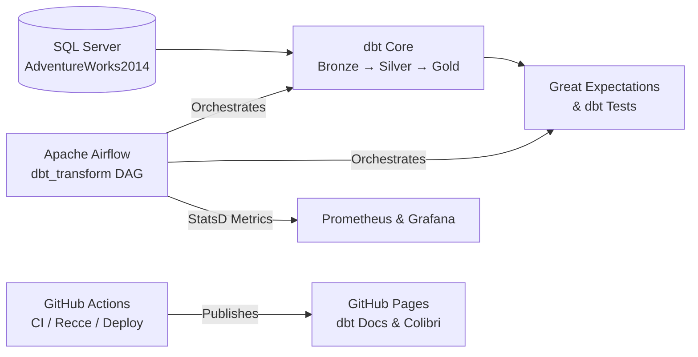

# DBT and Airflow Data Pipeline Project

[](https://github.com/LeNgocBao145/dataops-project/actions/workflows/dbt-ci.yml)
[](https://github.com/LeNgocBao145/dataops-project/actions/workflows/python-quality.yml)
[](https://github.com/LeNgocBao145/dataops-project/actions/workflows/deploy.yml)
[](https://github.com/LeNgocBao145/dataops-project/actions/workflows/deploy-pages.yml)

End-to-end DataOps pipeline implementing a **Medallion Architecture (Bronze → Silver → Gold)** on SQL Server (`AdventureWorks2014`) using **dbt Core**, **Apache Airflow**, **Great Expectations**, **Prometheus/Grafana**, and **GitHub Actions**.

## Documentation & Data Lineage (GitHub Pages)

- **Column-Level Lineage (dbt-colibri)**: https://lengocbao145.github.io/dataops-project/lineage/
- **dbt Documentation**: https://lengocbao145.github.io/dataops-project/dbt-docs/

## High-Level Architecture



## Quick Start

1. **Configure environment variables:**
   ```bash
   cp airflow/.env.example airflow/.env
   ```
2. **Start all services:**
   ```bash
   docker-compose up -d --build
   ```
3. **Restore the AdventureWorks2014 database:**
   ```bash
   docker-compose exec sqlserver /tmp/restore_db.sh
   ```
4. **Install dbt dependencies and verify connectivity:**
   ```bash
   docker-compose exec dbt dbt deps --profiles-dir .
   docker-compose exec dbt dbt debug --profiles-dir .
   ```
5. **Access Web UIs:**
   - **Airflow**: http://localhost:8085 (`admin` / `admin`)
   - **Grafana**: http://localhost:3000 (`admin` / `admin`)
   - **Prometheus**: http://localhost:9090

For full installation steps, environment configuration, and verification, see the [Setup Guide](./docs/SETUP_GUIDE.md).

## Project Documentation

| Document | Description |
| --- | --- |
| [Setup Guide](./docs/SETUP_GUIDE.md) | Prerequisites, environment variables, Docker Compose setup, DB restore, and UI access |
| [Model & Data Dictionary](./docs/MODEL_DOCUMENTATION.md) | Medallion layers (Bronze, Silver, Gold Core & Marts), grain, keys, and business logic |
| [Airflow Orchestration](./docs/AIRFLOW_ORCHESTRATION.md) | `dbt_transform` DAG stages, TaskGroups, retries, Slack/email alerts, and local triggers |
| [Testing & Data Quality](./docs/TESTING_AND_DATA_QUALITY.md) | dbt schema/generic/singular tests, Great Expectations suites, and smoke tests |
| [CI/CD Pipeline](./docs/CICD_PIPELINE.md) | GitHub Actions workflows, deployment flow, and branch-to-environment mapping |
| [Deployment Runbook](./docs/DEPLOYMENT_RUNBOOK.md) | Standard operating procedures for deployments, rollbacks, and success-rate tracking |
| [Troubleshooting Guide](./TROUBLESHOOTING.md) | Common Docker, SQL Server, Airflow, dbt, Great Expectations, and CI/CD issues |
