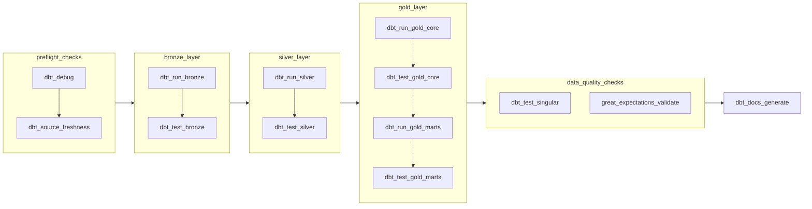

# Airflow Orchestration (`dbt_transform`)

Apache Airflow orchestrates the AdventureWorks **dbt + Great Expectations** Medallion pipeline on SQL Server.

## Overview

- **DAG ID**: `dbt_transform` ([dbt_dag.py](../airflow/dags/dbt_dag.py))
- **Schedule**: `@daily` (configurable via `DBT_DAG_SCHEDULE` environment variable, e.g. `@hourly` or cron)
- **Catchup**: Disabled (`catchup=False`)
- **Concurrency**: `max_active_runs=1`
- **DAG Run Timeout**: `2 hours`

## Pipeline Architecture & Task Dependencies

The DAG uses Airflow `TaskGroup`s to execute dbt models in Medallion order with quality gates between every layer:



### Stage Breakdown

1. **`preflight_checks`**
   - `dbt_debug`: Verifies dbt profile configuration and SQL Server connectivity.
   - `dbt_source_freshness`: Validates source table freshness against [sources.yml](../dbt/models/sources.yml).
2. **`bronze_layer`**
   - `dbt_run_bronze`: Runs staging views in `models/bronze`.
   - `dbt_test_bronze`: Runs schema/generic tests on Bronze models before Silver starts.
3. **`silver_layer`**
   - `dbt_run_silver`: Builds cleansed and conformed tables in `models/silver`.
   - `dbt_test_silver`: Runs schema/generic tests on Silver models before Gold starts.
4. **`gold_layer`**
   - `dbt_run_gold_core` -> `dbt_test_gold_core`: Builds and tests core star-schema dimensions and facts (`models/gold/core`).
   - `dbt_run_gold_marts` -> `dbt_test_gold_marts`: Builds and tests analytical business marts (`models/gold/marts`).
5. **`data_quality_checks`** (runs in parallel)
   - `dbt_test_singular`: Executes custom SQL business-logic assertions in `dbt/tests/`.
   - `great_expectations_validate`: Runs Great Expectations validation suites ([run_gx_suite.py](../great_expectations/run_gx_suite.py)) against Silver and Gold tables.
6. **`dbt_docs_generate`**
   - Generates dbt documentation artifacts (`manifest.json`, `catalog.json`) once all upstream stages succeed (`TriggerRule.ALL_SUCCESS`).

## Error Handling, Retries & Notifications

| Setting | Value | Purpose |
| --- | --- | --- |
| `retries` | `2` | Automatically retries transient failures |
| `retry_delay` | `5 minutes` | Initial wait before retry |
| `retry_exponential_backoff` | `True` | Backs off exponentially between retries |
| `max_retry_delay` | `30 minutes` | Caps backoff delay |
| `execution_timeout` | `30 minutes` | Prevents hung tasks from blocking the queue |
| `email_on_failure` | `True` | Sends SMTP email via Airflow ([airflow/.env.example](../airflow/.env.example)) |
| `on_failure_callback` | `on_task_failure_callback` | Logs structured failure + sends Slack alert |
| `on_retry_callback` | `on_task_retry_callback` | Logs retry attempt + sends Slack warning |
| `on_success_callback` | `on_dag_success_callback` | Logs DAG completion + sends Slack info alert |

### Supporting Utilities

- [alerting.py](../airflow/dags/utils/alerting.py): `AlertManager` dispatches formatted Slack webhook payloads (when `SLACK_WEBHOOK_URL` is set) and falls back cleanly to structured logging when unconfigured.
- [logging_utils.py](../airflow/dags/utils/logging_utils.py): `DataOpsLogger` and `log_task_execution` provide consistent event and metric logging across tasks.

## Environment Variables

Copy [airflow/.env.example](../airflow/.env.example) to `airflow/.env` and configure:

| Variable | Default | Description |
| --- | --- | --- |
| `DBT_CONTAINER_NAME` | `dbt_airflow_project-dbt-1` | Target dbt Docker container name |
| `DBT_DAG_SCHEDULE` | `@daily` | Airflow schedule interval (`@daily`, `@hourly`, or cron) |
| `ALERT_EMAIL` | `admin@example.com` | Recipient email for task failure alerts |
| `SLACK_WEBHOOK_URL` | `""` | Optional Slack incoming webhook URL for alerts |

## Local Verification

```bash
# Check Python syntax
python -m py_compile airflow/dags/dbt_dag.py airflow/dags/utils/alerting.py

# Trigger DAG manually inside Airflow scheduler container
docker exec dbt_airflow_project-airflow-scheduler-1 airflow dags trigger dbt_transform
```
